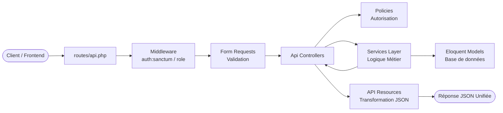
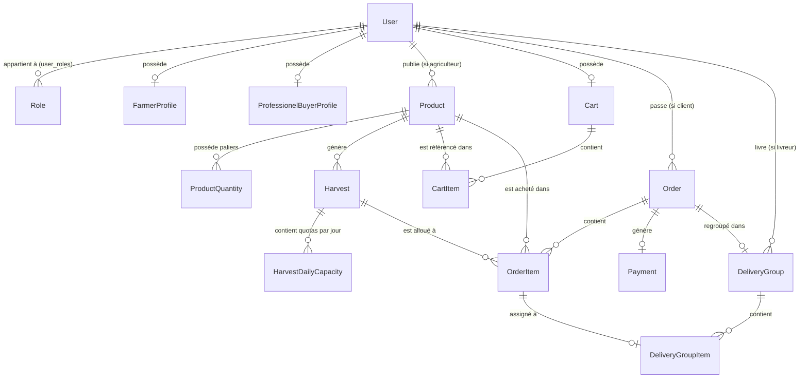

# 🗺️ AgriFlow API — Architecture & Backend Map

> Ce document résume l'architecture globale du backend **AgriFlow (Laravel 12 / PHP 8.5)** : les classes, les méthodes, les relations et le flux de données entre chaque composant.

---

## 1. 🔄 Vue d'ensemble du Cycle de Traitement (Architecture Flow)

Chaque requête HTTP suit un pipeline standardisé, sécurisé et découplé en couches :



---

## 2. 👥 Rôles & Espaces d'Accès

Le système utilise une table pivot `user_roles` et le middleware [`EnsureUserHasRole`](file:///c:/Users/nn/OneDrive/Desktop/AgriFlow/agriflow-api/app/Http/Middleware/EnsureUserHasRole.php) :

* **Admin (`admin`)** : Contrôle total (validation agriculteurs, gestion utilisateurs, modération produits/commandes).
* **Agriculteur (`farmer`)** : Gestion du profil agricole, produits, stocks, récoltes et commandes reçues.
* **Acheteur Pro (`professional_buyer`)** : Profil entreprise, commandes groupées, facturation pro.
* **Client (`client`)** : Consultation catalogue, panier, passage de commande, paiement, suivi.
* **Livreur (`livreur`)** : Consultation et mise à jour du statut des groupes de livraison assignés.

---

## 3. 🎮 Contrôleurs & Fonctions (Controllers Map)

Tous les contrôleurs héritent de [`Controller`](file:///c:/Users/nn/OneDrive/Desktop/AgriFlow/agriflow-api/app/Http/Controllers/Controller.php) qui utilise le trait [`ApiResponse`](file:///c:/Users/nn/OneDrive/Desktop/AgriFlow/agriflow-api/app/Http/Controllers/ApiResponse.php) pour normaliser les réponses JSON (`success`, `created`, `error`, `unauthorized`).

### 🔐 Authentification & Profils
| Contrôleur | Méthode | Rôle / Accès | Description |
| :--- | :--- | :--- | :--- |
| **`AuthController`** | `register(RegisterRequest, AuthService)` | Public | Inscription avec assignation du rôle initial et token Sanctum |
| | `login(LoginRequest, AuthService)` | Public | Connexion par email/mot de passe et génération du token |
| | `me(Request)` | `auth:sanctum` | Retourne l'utilisateur connecté avec ses rôles |
| | `logout(Request, AuthService)` | `auth:sanctum` | Révocation du token d'accès actif |
| **`AccountController`** | `show(Request)` | `auth:sanctum` | Détails du compte personnel |
| | `update(UpdateAccountRequest)` | `auth:sanctum` | Mise à jour nom, téléphone, zone |
| | `updatePassword(Request)` | `auth:sanctum` | Changement sécurisé du mot de passe |
| **`ProfileController`** | `show(Request)` | `auth:sanctum` | Profil selon rôle (Agriculteur / Acheteur pro) |
| | `updateFarmer(...)` | `role:farmer` | Mise à jour exploitation, superficie, certification |
| | `updateBuyer(...)` | `role:professional_buyer` | Mise à jour registre de commerce, ICE, type d'activité |

### 🛍️ Catalogue & Produits
| Contrôleur | Méthode | Rôle / Accès | Description |
| :--- | :--- | :--- | :--- |
| **`PublicController`** | `products(Request)` | Public | Liste des produits disponibles et actifs pour les visiteurs |
| | `productDetails($id)` | Public | Détails d'un produit spécifique |
| **`ProductController`** | `index(Request, ProductService)` | `auth:sanctum` | Liste des produits de l'agriculteur connecté |
| | `store(StoreProductRequest, ProductService)` | `role:farmer` | Création d'un nouveau produit |
| | `show(Request, Product, ProductService)` | `auth:sanctum` | Détail d'un produit (protégé par Policy) |
| | `update(UpdateProductRequest, Product, ...)` | `role:farmer` | Modification d'un produit |
| | `destroy(Request, Product, ProductService)` | `role:farmer` | Suppression d'un produit |
| | `manageQuantity(Request, Product, ...)` | `role:farmer` | Gestion des seuils de stock et prix par quantité |

### 🌾 Récoltes & Prévisions (Harvests)
| Contrôleur | Méthode | Rôle / Accès | Description |
| :--- | :--- | :--- | :--- |
| **`HarvestController`** | `index(Request)` | `auth:sanctum` | Liste générale des récoltes |
| | `store(StoreHarvestRequest, HarvestService)`| `role:farmer` | Planification d'une nouvelle récolte avec capacités journalières |
| | `show($id)` | `auth:sanctum` | Consultation détaillée d'une récolte |
| | `update(UpdateHarvestRequest, $id, ...)` | `role:farmer` | Mise à jour des estimations et dates |
| | `destroy($id, HarvestService)` | `role:farmer` | Annulation / suppression d'une récolte |
| | `updateHarvestStatus($id, $status)` | `role:farmer` | Changement de statut (`planned`, `in_harvest`, `completed`, `cancelled`) |
| | `farmerHarvests(Request, HarvestService)` | `role:farmer` | Récoltes spécifiques de l'agriculteur connecté |

### 🛒 Panier & Commandes (Orders & Cart)
| Contrôleur | Méthode | Rôle / Accès | Description |
| :--- | :--- | :--- | :--- |
| **`CartController`** | `index(CartService)` | `auth:sanctum` | Récupère le panier en cours et le montant total |
| | `store(Request, CartService)` | `auth:sanctum` | Ajoute un produit au panier |
| | `update(Request, $item, CartService)` | `auth:sanctum` | Modifie la quantité d'un article |
| | `destroy($item, CartService)` | `auth:sanctum` | Supprime un article du panier |
| | `clear(CartService)` | `auth:sanctum` | Vide entièrement le panier |
| **`OrderController`** | `index(Request, OrderService)` | `auth:sanctum` | Liste des commandes de l'utilisateur connecté |
| | `store(StoreOrderRequest, OrderService)` | `auth:sanctum` | Validation du panier en commande avec réservation des capacités |
| | `show(Order)` | `auth:sanctum` | Détails d'une commande (protégé par `OrderPolicy`) |
| | `cancel(Order, OrderService)` | `auth:sanctum` | Annule une commande et libère les quotas de récolte |
| | `updateStatus(Request, Order, ...)` | `role:admin` | Mise à jour du statut (`pending`, `confirmed`, `shipped`, `delivered`, `cancelled`) |

### 💳 Paiements & Livraisons
| Contrôleur | Méthode | Rôle / Accès | Description |
| :--- | :--- | :--- | :--- |
| **`PaymentController`** | `initiate(Order, PaymentService)` | `auth:sanctum` | Initialisation de la transaction pour une commande |
| | `confirm(Payment, PaymentService)` | `auth:sanctum` | Confirmation du paiement |
| | `refund(Payment, PaymentService)` | `role:admin` | Remboursement d'une transaction |
| | `myPayments(Request, PaymentService)` | `auth:sanctum` | Historique des paiements de l'utilisateur |
| **`DeliveryController`**| `index(DeliveryService)` | `role:admin` | Liste de tous les groupes de livraison |
| | `store(Request, DeliveryService)` | `role:admin` | Regroupement de commandes par zone géographique |
| | `show(DeliveryGroup)` | `auth:sanctum` | Détail d'un groupe de livraison |
| | `assign(DeliveryGroup, $userId, ...)` | `role:admin` | Assigne un groupe à un chauffeur/livreur |
| | `updateStatus(DeliveryGroup, $status)`| `role:livreur` | Mise à jour du statut (`assigned`, `in_transit`, `delivered`) |

### 📊 Dashboards & Administration
| Contrôleur | Méthode | Rôle / Accès | Description |
| :--- | :--- | :--- | :--- |
| **`FarmerDashboardController`** | `stats(FarmerDashboardService)` | `role:farmer` | Chiffre d'affaires, ventes, volume récolté |
| | `receivedOrders(...)` | `role:farmer` | Commandes en attente de préparation |
| | `popularProducts(...)` | `role:farmer` | Top des produits les plus demandés |
| **`CustomerDashboardController`**| `browse(...)` | `auth:sanctum` | Catalogue personnalisé et recommandations |
| | `orderHistory(...)` | `auth:sanctum` | Suivi et historique d'achats |
| | `trackOrder(Order)` | `auth:sanctum` | Statut de préparation et de livraison en direct |
| **`AdminController`** | `stats(AdminService)` | `role:admin` | Métriques globales de la plateforme |
| | `listUsers()`, `deleteUser()` | `role:admin` | Modération des comptes utilisateurs |
| | `createDeliveryUser(CreateDeliveryUserRequest)` | `role:admin` | Création d'un compte livreur officiel |
| | `approveFarmer($user)`, `rejectFarmer($user)` | `role:admin` | Validation ou refus des comptes agriculteurs |
| | `disableProduct($product)`, `enableProduct(...)` | `role:admin` | Activation/désactivation d'un produit au catalogue |

---

## 4. ⚙️ Couche Services & Logique Métier (Services Layer)

Les contrôleurs restent "fins" (*thin controllers*) et délèguent le travail lourd aux Services :

```
app/Services/
├── AuthService.php              -> Hachage mots de passe, tokens Sanctum, attribution rôle
├── ProductService.php          -> Filtrage produits, calcul des remises sur quantité
├── HarvestService.php          -> Calcul des dates de récolte et planification des quotas
├── OrderService.php            -> ⚡ Moteur de réservation avec Row Locking (évite l'overbooking)
├── CartService.php             -> Synchronisation panier base de données & montants totaux
├── PaymentService.php          -> Gestion des états financiers et transactions
├── DeliveryService.php         -> Groupement par zone logistique et dispatch livreurs
├── FarmerDashboardService.php  -> Agrégrations SQL et statistiques de rendement
└── AdminService.php            -> Indicateurs globaux et modération
```

> [!NOTE]
> **Le moteur de réservation (`OrderService.php`)** utilise `DB::transaction` avec un verrou pessimiste (`lockForUpdate()`) sur les récoltes et les capacités quotidiennes (`HarvestDailyCapacity`). Cela garantit qu'aucune commande concurrente ne dépasse la capacité maximale de production de l'agriculteur.

---

## 5. 🗄️ Modèles & Schéma Relationnel (Data Map)



---

## 6. 🛡️ Sécurité & Règles (Policies & Middleware)

1. **[`EnsureUserHasRole.php`](file:///c:/Users/nn/OneDrive/Desktop/AgriFlow/agriflow-api/app/Http/Middleware/EnsureUserHasRole.php)** : Intercepte les requêtes avec `role:admin`, `role:farmer`, etc. Rejette automatiquement avec un code HTTP 403 si le rôle requis est absent.
2. **Policies dédiées (`app/Policies/`)** :
   * [`ProductPolicy.php`](file:///c:/Users/nn/OneDrive/Desktop/AgriFlow/agriflow-api/app/Policies/ProductPolicy.php) : Un agriculteur ne peut modifier ou supprimer que ses propres produits.
   * [`HarvestPolicy.php`](file:///c:/Users/nn/OneDrive/Desktop/AgriFlow/agriflow-api/app/Policies/HarvestPolicy.php) : Seul le propriétaire de la récolte peut changer son statut ou ses prévisions.
   * [`OrderPolicy.php`](file:///c:/Users/nn/OneDrive/Desktop/AgriFlow/agriflow-api/app/Policies/OrderPolicy.php) : Un client ne peut voir et annuler que ses propres commandes.
   * [`DeliveryPolicy.php`](file:///c:/Users/nn/OneDrive/Desktop/AgriFlow/agriflow-api/app/Policies/DeliveryPolicy.php) : Accès restreint aux livreurs désignés et aux administrateurs.

